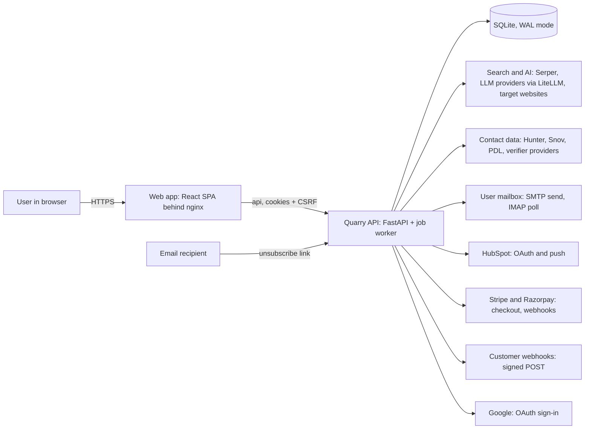
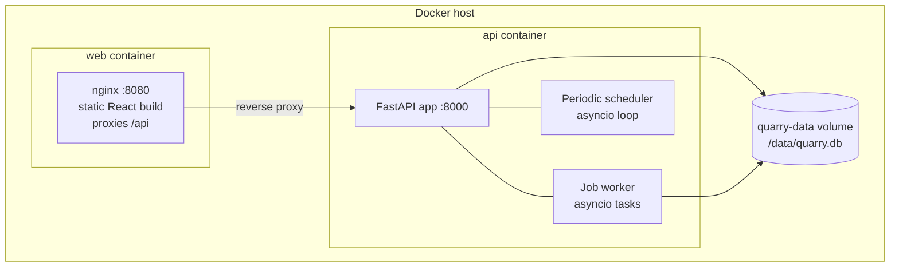
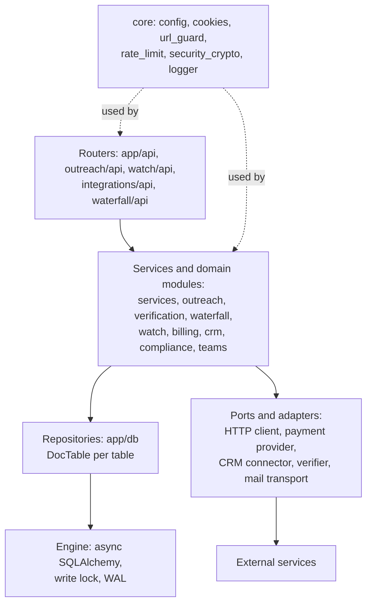
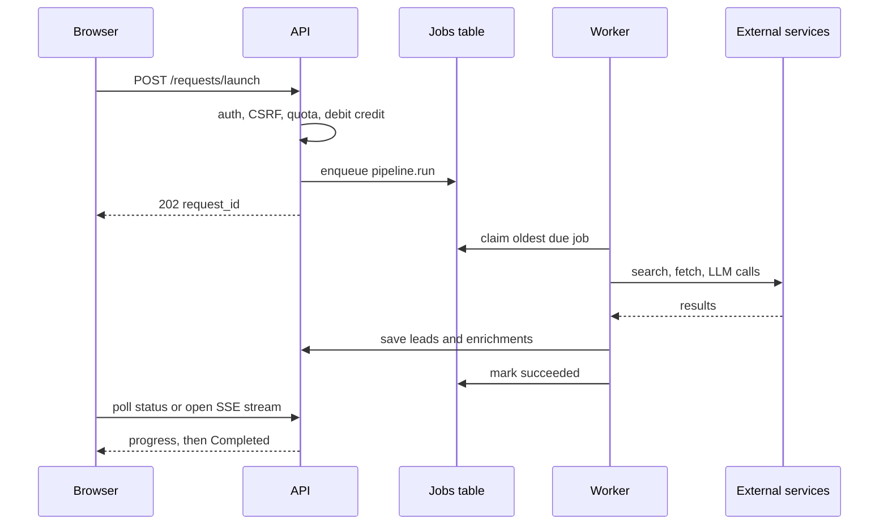
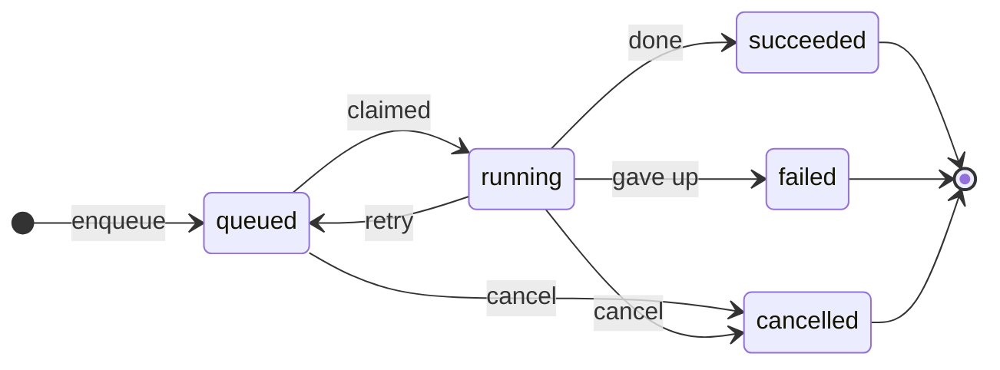
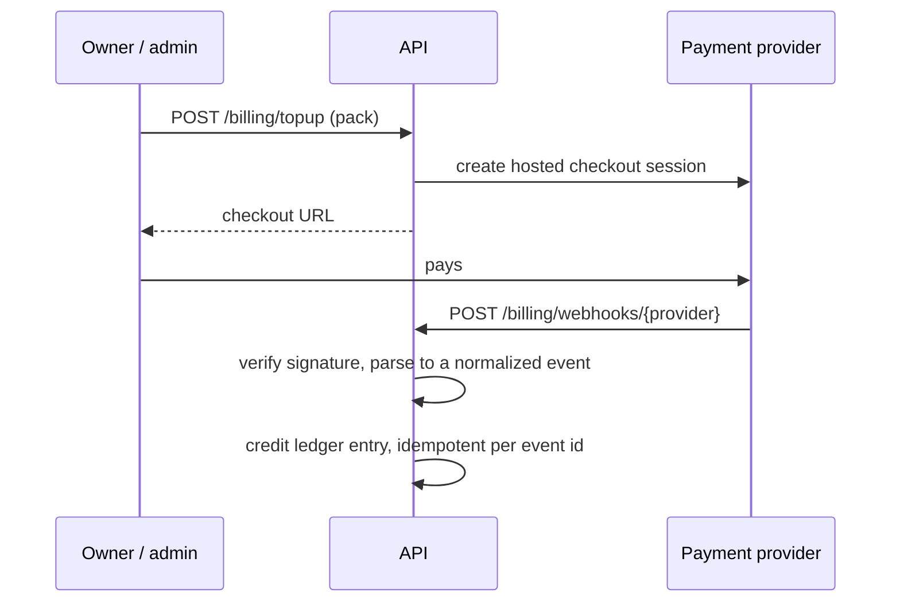
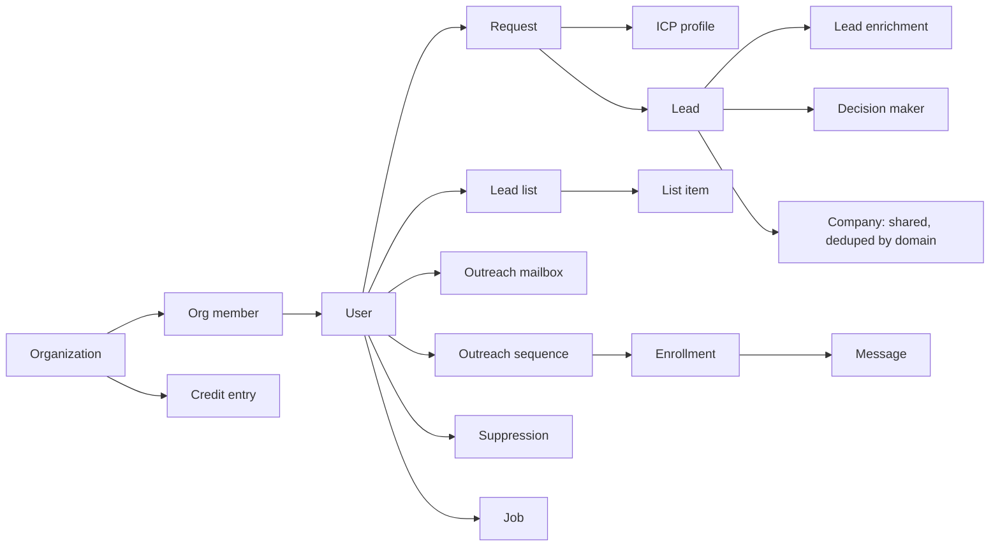
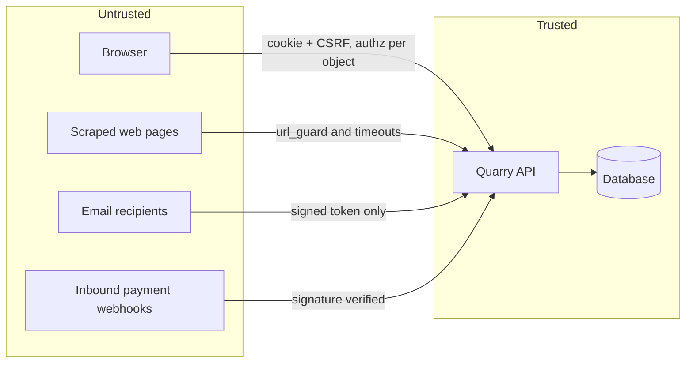

| | |
|---|---|
| **Document** | High-level system design (architecture, data flow, runtime, decisions) |
| **Version** | 1.0 |
| **Date** | 2026-11-10 |
| **Applies to** | Current code: API in `apps/api`, web app in `apps/web` |
| **Companion docs** | PRD (01), Data Model and API Reference (03), Security and Compliance (04), Operations (05) |

---

# 1. Context and design goals

Quarry takes an Ideal Customer Profile, finds matching companies on the live web, enriches and scores them, verifies
contacts, and then lets the user send mail or hand the list to a CRM. The design has to satisfy goals that sometimes
pull against each other:

| Goal | Consequence for the design |
|---|---|
| Operable by one person | One deployable unit, one datastore, no broker or cache cluster |
| Long runs must not block users | Every long task is a durable background job; the HTTP request returns a request id |
| Runs must survive restarts | Jobs are rows in the database, recovered at startup |
| Handle other people's personal data responsibly | Suppression, erasure, retention and provenance are in the data model, not bolted on |
| Fetch untrusted URLs safely | A single outbound-fetch guard in front of every network call that a user or a web page can influence |
| Cheap to run | Bring-your-own keys, free-tier LLMs through LiteLLM, SQLite |
| Easy to grow later | Ports and adapters around every external service; a documented path to Postgres |

# 2. System context

External actors: signed-in users, email recipients who opt out, payment providers that call back, and the customer's
own systems that receive webhooks or call the public API with a key.

# 3. Architecture overview

## 3.1 Deployment view

* Two containers (`docker-compose.yml`). nginx serves the static build and proxies `/api` to the API, so the browser
  sees one origin and cookies are same-site.
* The API runs **one process, one worker**. The job claim, the periodic scheduler and the SQLite write lock are all
  in-process, which is why scaling out needs the Postgres step in section 12.
* TLS terminates in front of the containers (load balancer or reverse proxy).

## 3.2 Logical layers

| Layer | Responsibility | Rule |
|---|---|---|
| Routers | Validate input, authenticate, authorize, call a service, shape the response | No business logic, no direct SQL |
| Services / domain | Business rules, orchestration, the pipeline | Talk to the database only through repositories |
| Repositories | One module per table; JSON-document storage with a few real key columns | The only code that builds queries |
| Ports and adapters | Interfaces around every external system | Swappable in tests (a fake HTTP client, mock payment provider) |
| Core | Cross-cutting: config, auth cookies, SSRF guard, rate limit, crypto | No imports from domain modules |

## 3.3 Frontend architecture

| Aspect | Choice |
|---|---|
| Framework | React 18 with React Router 6, built by Vite 5 |
| Styling | Tailwind CSS 3 with CSS variables for seven palettes (Quarry, Midnight, Amethyst, Emerald, Sunset, Rosewood, Graphite) and a light/dark toggle |
| Motion | GSAP and the `motion` library for reveals and transitions; reduced-motion respected |
| API access | `src/api.js` and `src/api.p3.js`; cookie session plus CSRF header; refresh on 401 |
| State | Component state and context (`context/`); no global store |
| Routes | Public: login, register, forgot/reset password, privacy, opt-out, invite, OAuth callbacks. Protected inside `Layout`: lead requests, dashboard, new request wizard, request intake, direct companies, request details, lead lists, outreach, watch, integrations, CRM integrations, team, billing, compliance, profile |
| Tests | Vitest and Testing Library; 375 passing across 39 files |

# 4. Core flows

## 4.1 Launching a lead request

Steps inside `pipeline.run`:

1. **Queries.** The LLM turns the ICP into search queries, stored on the request.
2. **Search.** Serper returns Google results using the user's own key, else the server key. Results are cached in
   `serper_cache`.
3. **Triage.** URLs are de-duplicated by canonical host, then classified as a company site or a directory. Directories
   are expanded into nested company URLs.
4. **Extract in batches.** For each company: fetch the site (httpx, optional Playwright for script-heavy pages), read
   structured data, call the LLM for structured lead fields and a match score, drop the seller itself and junk pages,
   find decision makers. Continue until the requested count or the candidate pool is exhausted (one extra query round
   is allowed).
5. **Enrich.** Tech stack and infrastructure detection, firmographics from public LinkedIn search results, funding,
   news, job and social signals.
6. **Filter and save.** Optional ICP score filter (off by default), suppression check, save, mark `Completed` or
   `Failed` with a reason.

The lead and competitor pipelines run in parallel with the main run.

## 4.2 Durable job queue

* The claim (`queued` to `running`, `attempts += 1`) happens inside one write transaction.
* "retry" means an error with attempts left (after backoff) or a run recovered at startup because its process died. "gave up" means a `PermanentJobError` or attempts exhausted.
* Retry delay is `min(max, base * 2^(attempt-1))`.
* On startup, rows still `running` belong to a dead process. They are re-queued, or failed if attempts are used up.
* The queue has no native recurring jobs, so a small in-process scheduler enqueues the periodic work below.

| Job kind | Cadence | Purpose |
|---|---|---|
| `pipeline.run`, `pipeline.direct` | On demand | Discovery and direct-company runs |
| `lead.retry_enrichment` | On demand | Re-run AI extraction for one lead |
| `crm.push` | On demand | Push a list to HubSpot |
| `outreach.send_due` | Every minute | Send due sequence steps |
| `outreach.poll_replies` | Every 5 minutes | IMAP poll for replies and bounces |
| `webhooks.deliver` | Every minute and on emit | Deliver and retry webhooks |
| `signals.scan` | Every 6 hours | Hiring, funding, tech-stack signals |
| `searches.run` | Every 6 hours | Run saved searches and send alerts |

## 4.3 Outreach send loop

Every minute the `outreach.send_due` job walks the enrollments whose next step is due and applies these checks in
order:

| # | Check | If it fails |
|---|---|---|
| 1 | The contact is not suppressed and the enrollment is not already finished (replied, bounced, unsubscribed, completed) | Mark suppressed or skip |
| 2 | The mailbox is not paused | Wait |
| 3 | The current time is inside the send window for the contact's timezone | Reschedule to the next window slot |
| 4 | The mailbox is under today's cap (the warmup ramp applies to new mailboxes) | Wait until tomorrow |
| 5 | Render the template, add the footer and the `List-Unsubscribe` headers, then send over SMTP | Retry up to 3 attempts; a permanent error fails the step at once |
| 6 | On success, record the message and advance the enrollment to the next step | n/a |

Inbound handling (`outreach/inbound.py`): every 5 minutes each mailbox is polled over IMAP from the last seen UID.
A message is matched to a sent message through `Message-ID`, `In-Reply-To` and `References`. Delivery Status
Notifications are parsed to detect bounces; auto-replies are detected and ignored. A real reply ends the
enrollment; a bounce is recorded and feeds the hard-bounce rate that can auto-pause the mailbox.

## 4.4 Email verification

Statuses: `verified`, `likely`, `risky`, `invalid`. A result also carries `reason`, `method`, `checked_at`, optional
`catch_all` and `provider`. Checks run cheapest first and stop at the first decisive answer:

| Step | Outcome |
|---|---|
| 1. Syntax | Bad syntax is `invalid` |
| 2. Disposable-domain list | Disposable provider is `risky` |
| 3. DNS MX lookup | No MX records is `invalid` |
| 4. Paid provider (only if the user configured one) | Provider status is used; if the provider errors, Quarry falls back to the free checks and says so in the reason |
| 5. Free baseline | MX found but mailbox not probed is `likely` |
| 6. Optional SMTP RCPT probe | Rejected is `invalid`; accepted on a catch-all domain is `risky`; accepted is `verified`; inconclusive stays `likely` |
| 7. Role-account downgrade | `info@`, `sales@` and similar shared inboxes drop `verified` or `likely` to `risky` |

The SMTP probe is optional because many cloud hosts block port 25, and it refuses MX hosts that resolve to private
addresses.

## 4.5 Waterfall enrichment

Providers are tried in order `scrape, hunter, snov, pdl` through one interface. Each provider uses the user's own key
(or a platform key). A credit is charged **only on a hit**, so a miss costs nothing. A `fallback_suppressions` table
records providers that already failed for a person so the waterfall does not retry them. Email-lookup credits are a
separate balance from request credits.

## 4.6 Billing and credits

The request quota check and the credit debit run in one write transaction, so concurrent launches cannot overshoot.
The `mock` provider credits instantly and exists only for local demos.

## 4.7 CRM push

`POST /integrations/hubspot/push` returns 202 with a `job_id`. The `crm.push` handler upserts companies and contacts
through the `CrmConnector` interface and records per-lead sync status (`queued`, `syncing`, `synced`, `failed`) in
`crm_sync`. The UI polls the job and the sync endpoint. A new CRM needs a new connector class, not a pipeline change.

# 5. Data architecture

## 5.1 Storage model

SQLite in WAL mode with foreign keys on. Every table has a string primary key `id` and a JSON `data` column; only
fields used for filtering, sorting or uniqueness are real columns. This "document table" pattern (`app/db/docstore.py`)
keeps schema changes rare. The trade-offs are explicit:

| Benefit | Cost |
|---|---|
| Adding a field to a document needs no migration | No database-level type checking inside `data` |
| Few migrations | Filtering on a non-key field needs a real column and a migration |
| Simple repository layer | Harder to run ad hoc analytical SQL |

## 5.2 Concurrency

SQLite allows one writer. Writers queue on a process-wide `asyncio.Lock` (first come, first served) and hold it for
the whole `async with` session block. Readers use WAL snapshots and are not blocked. This is correct and simple for one
process; it is the main reason the deployment is a single API worker.

## 5.3 Schema evolution

`create_all` never alters an existing table, so changes go through a versioned migration runner
(`app/db/migrations.py`). It runs inside `connect_db()` before the app serves, applies pending migrations in one
transaction (a failure rolls back), and records versions in `schema_migrations`. Version 1 is the baseline, so
databases created by older code are adopted without data loss. A test asserts every table name is unique across
feature modules; startup logs a `Schema drift` warning when a model column is missing in the database.

## 5.4 Entity overview

The full table list with key columns is in document 03.

# 6. Security architecture

## 6.1 Trust boundaries

## 6.2 Controls by layer

| Layer | Control |
|---|---|
| Identity | Short-lived JWT access token and rotating refresh token in HttpOnly cookies; refresh tokens stored hashed and revocable; passwords hashed with bcrypt; Google sign-in through a server redirect (no tokens in URLs) |
| CSRF | Double-submit token: unsafe methods with cookie auth must send `X-CSRF-Token` equal to the CSRF cookie (constant-time compare). Bearer-token clients are exempt |
| Authorization | Roles `owner > admin > member > viewer`; per-endpoint minimum role; every resource lookup is scoped to the owner or workspace |
| Rate limiting | In-memory sliding window on auth routes; uniform login errors |
| SSRF | All outbound fetches of influenced URLs pass `core/url_guard.py`: public addresses only, DNS resolved once and the connection pinned to the checked IP, redirects re-checked at each hop, TLS verified against the real hostname |
| Secrets | User Serper keys, mailbox credentials and provider keys encrypted with Fernet (AES-128-CBC plus HMAC) using a key derived from `SECRET_KEY`; secrets never placed in job payloads; public API keys stored only as SHA-256 hashes (shown once, prefix `qk_`) |
| Webhooks out | HMAC-SHA256 over `timestamp.body`, with a 5-minute tolerance on verify; exponential-backoff retries at 1, 5, 30, 120, 720 minutes, then give up |
| Webhooks in | Payment webhooks verified by signature; handlers idempotent per event id |
| Data protection | Cascade deletion, suppression ledger, retention purge, audit log, region flags |
| CORS | Explicit origin list with credentials |

Known residual risks: Playwright's browser does its own DNS (checked, not pinned; Playwright is off by default); the
HTTP client ignores environment proxy settings; the scraper has no response-size cap. Details in document 04.

# 7. Reliability and failure handling

| Failure | Behavior |
|---|---|
| Process restart mid-run | Running jobs recovered to `queued` and resumed; pipeline is idempotent per lead URL but may repeat API spend |
| LLM provider error, empty or unparsable reply | Logged with model and purpose; lead extraction keeps the lead as `enrichment_failed` with a reason and a Retry action |
| Serper 401, 403, 429 | Failure reason stored on the request and shown to the user |
| Mailbox send failure | Retried to 3 attempts; permanent errors fail at once |
| Hard-bounce rate above 2% (min 20 sent) | Mailbox auto-paused with a reason; resumed manually |
| Webhook endpoint down | Backoff retries over about 14 hours, delivery log visible |
| Payment webhook replayed | Idempotent per event; no double credit |
| Queue write failure on launch | Falls back to in-process background task (does not survive restart) |
| Deleting a request or account | Its leads, decision makers and enrichments are deleted too (third-party personal data); shared company facts are kept |

# 8. Observability

* Structured application logs through `core/logger.py`. Scraped personal data is not logged at INFO.
* LLM failures log model, purpose, reason and detail.
* User-visible failure reasons on requests; per-job status, attempts, error and result via `/api/jobs`.
* `usage_events` rows record calls and estimated cost per run; `/api/usage/summary` exposes them.
* `audit_log` records compliance-relevant actions.
* `GET /api/health` for container health checks.
* **Gap:** no metrics backend, tracing or alerting. Recommended before hosting: request latency and error rate,
  queue depth and oldest queued job age, job failure rate, and LLM spend.

# 9. Performance and capacity

| Dimension | Current | Note |
|---|---|---|
| Concurrent jobs | `JOB_WORKER_CONCURRENCY`, default 4 | Bounded; one writer serializes saves |
| Poll interval | `JOB_POLL_INTERVAL_SECONDS`, default 1.0 | |
| External timeouts | Serper 30 s, page scrape 15 s, LLM 30 s | |
| Cost estimate | Serper about $0.001 per call, LLM about $0.002 per call (env-tunable, order of magnitude only) | |
| Per-user quota | 30 runs and $20 estimated cost per month by default; overridable per user | Plus plan limits |
| Run duration | **Not measured.** Time the first real runs and record p50 and p95 | Open item |

The design assumes tens of concurrent users, not thousands. The first bottleneck will be the single SQLite writer,
then the single-process job worker.

# 10. Key design decisions

| # | Decision | Alternatives | Why chosen | Revisit when |
|---|---|---|---|---|
| D1 | SQLite with JSON-document tables | Postgres from day one | Zero ops, simple, free; schema churn is low | More than one API instance, or heavy analytical queries |
| D2 | Jobs as a database table | Redis or a broker | No new infrastructure; durable by default | Multiple workers (move to `SELECT ... FOR UPDATE SKIP LOCKED`) |
| D3 | HttpOnly cookies plus CSRF | Tokens in localStorage | Resistant to token theft by script injection | Third-party embedding |
| D4 | SMTP and IMAP for mailboxes | Gmail and Microsoft OAuth | Avoids restricted-scope security assessments | Demand for one-click connect justifies the review cost |
| D5 | Bring-your-own provider keys | Resell vendor data | Apollo-style plans restrict resale; cost lands on the user | A negotiated data license |
| D6 | LiteLLM with fallback models | One provider SDK | Free-tier models and automatic failover | A single provider gives clear accuracy wins |
| D7 | Four-state email status with timestamps | Boolean "verified" | The top competitor complaint is inaccurate data | Never; add providers instead |
| D8 | Ports and adapters for externals | Direct SDK calls | Testable, swappable (payments, CRM, verifier) | n/a |
| D9 | Compliance in the data model | A later add-on | Erasure and suppression are hard to retrofit | n/a |
| D10 | Single deployable unit | Microservices | One builder; simple operations | Team growth |

# 11. Technology stack

| Area | Technology |
|---|---|
| Backend | Python 3.12+ (CI uses 3.13), FastAPI, uvicorn, Pydantic, async SQLAlchemy, aiosqlite |
| LLM | LiteLLM with OpenRouter and Groq models; optional Claude batch scoring (`claude-haiku-4-5` by default) |
| Scraping | httpx, BeautifulSoup, optional Playwright |
| Search | Serper |
| Crypto | `cryptography` Fernet, JWT, SHA-256 |
| Frontend | React 18, React Router 6, Vite 5, Tailwind 3, GSAP, motion, Radix Tabs, lucide and Tabler icons |
| Test and lint | pytest, ruff, vitest, Testing Library, eslint |
| Packaging | Docker, docker compose, nginx |
| CI | GitHub Actions: ruff, pytest, eslint, vitest, build |
| Payments | Stripe, Razorpay, mock |
| CRM | HubSpot |

# 12. Scaling path

1. **Now.** One API container, SQLite volume, one worker. Suitable for a pilot and early users.
2. **Postgres.** Replace the SQLite URL with Postgres (the engine is already SQLAlchemy async). Replace the in-process
   write lock with transactions, claim jobs with `FOR UPDATE SKIP LOCKED`, and move the migration runner to Alembic
   or keep it with Postgres-safe DDL.
3. **Multiple workers.** Run API and worker as separate processes. Move the periodic scheduler to a single elected
   leader or a cron-style trigger. Move the rate limiter to a shared store.
4. **Edge.** CDN for the static build, a managed secret store for `SECRET_KEY`, and key rotation with a versioned
   encryption key instead of one derived from `SECRET_KEY`.
5. **Observability.** Metrics, tracing and alerts.

# 13. Risks and limits

| Limit | Impact | Plan |
|---|---|---|
| Single SQLite writer | Throughput ceiling | Step 2 above |
| In-process queue and scheduler | No horizontal scaling | Step 3 |
| Pipeline resume re-runs from the start | Repeats API spend after a crash | Checkpoint per stage |
| Rate limiter is per-process memory | Resets on restart; not shared | Shared store |
| Encryption key derived from `SECRET_KEY` | Rotating the secret orphans stored credentials | Versioned data keys |
| No metrics or tracing | Slow incident diagnosis | Add before hosting |
| Playwright DNS not pinned | Residual SSRF path | Keep Playwright off, or run it in a network-isolated sandbox |
