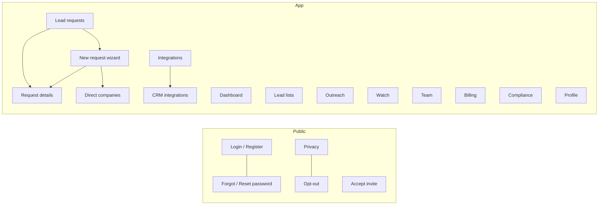

| | |
|---|---|
| **Document** | Information architecture, screens, interaction rules, visual system and accessibility |
| **Version** | 1.0 |
| **Date** | 2026-11-10 |

---

# 1. Design principles

1. **Premium and alive, not flat.** A rich look with purposeful motion. Motion never blocks work and respects
   reduced-motion settings.
2. **Show the truth about data.** Every email carries a status, a reason and a checked-at date; every fact can show
   its source. Never present a guess as a fact.
3. **No surprise cost.** Estimate before spend, show credits and quota where decisions are made.
4. **Failure is a state, not a blank.** Running, empty, failed and partial states are designed for every list.
5. **Guided, not technical.** A wizard that explains itself, for people who are not growth engineers.
6. **Accessible by default.** Keyboard reachable, labelled, with status conveyed by text and symbol as well as colour.

# 2. Information architecture

| Area | Route | Purpose |
|---|---|---|
| Lead requests | `/lead-requests` | Home: all runs, status, shared-with-me section |
| Dashboard | `/dashboard` | Totals, usage and recent activity |
| New request | `/new-request`, `/request/:id/intake`, `/request/:id/companies` | Wizard: product, ICP, estimate, launch; direct company upload |
| Request details | `/request/:id` | Leads, decision makers, competitors, drawer with signals and provenance, exports |
| Lead lists | `/lead-lists` | Named lists, export, shared-with-team section |
| Outreach | `/outreach` | Mailboxes, sequences, stats, enrollments |
| Watch | `/watch` | Saved searches, signal feed, alerts |
| Integrations | `/integrations`, `/integrations/crm` | API keys, webhooks, HubSpot |
| Team | `/team` | Members, roles, invites |
| Billing | `/billing` | Plan, balances, top-ups, invoices |
| Compliance | `/compliance` | Suppressions, erasure, audit log, retention |
| Profile | `/profile` | Account, Serper key, verifier settings |

The sidebar is resizable and collapsible, hides its scrollbar while staying scrollable, and includes the workspace
switcher. A help drawer gives in-context guidance.

# 3. Key screens

## 3.1 New request wizard

* Steps: describe the product (or paste text, URLs, files) then review the generated ICP, then choose the number of
  leads, then see the **estimate** (calls, cost, time) and optionally run a **sample**, then launch.
* Blank fields are never silently filled with hidden defaults; the wizard asks.
* The Serper key requirement is surfaced early rather than at the last step.

## 3.2 Request details (results)

* A table with match score, intent band, tech stack, region flag and email status chip (Verified, Likely, Risky,
  Invalid) with reason and checked-at on hover or in the drawer.
* States: running (live progress), empty, failed (with reason), and **partial** (a run that fails midway keeps and
  labels the leads found so far).
* Row actions: star, exclude, reject, add to list, verify email, retry enrichment, run waterfall, enroll in sequence.
* Exports in CSV, XLSX and PDF with the source-notice line.

## 3.3 Outreach

* Connect mailbox dialog with **Test connection** (SMTP and IMAP results shown inline) and a sticky footer so
  Cancel, Test connection and Connect stay visible on short screens.
* Sequence builder with up to 8 steps, variable chips, and a preview against a real contact.
* Stats lead with reply rate; opens are secondary because of mail-client privacy features.
* A paused mailbox shows its reason and a Resume action.

## 3.4 Compliance

Suppression list management, erasure, audit log and retention, written in plain language, with the public privacy and
opt-out pages linked.

# 4. Visual system

| Element | Specification |
|---|---|
| Palettes | Seven: Quarry, Midnight, Amethyst, Emerald, Sunset, Rosewood, Graphite. Chosen from the header, saved in the browser. Defined in `src/config/palettes.js` as CSS variables, so Tailwind classes such as `bg-surface/60` keep alpha support |
| Theme | Light and dark, toggle in the header |
| Surfaces | Translucent cards with blur, soft shadow and rounded corners (`card` utility) |
| Typography | System sans stack; bold tracked headings; tabular numerals for scores and counts |
| Layout | App shell with sidebar and header; content max-width per page; 16px minimum side gutter on phones |
| Components | `components/kit` (Button, Field, EmptyState, PageHeader, toast), `components/ui` (animated modal, effects), `components/motion` (Reveal), page-level `p3/ui` (Dialog, Tabs, Section, Pill, Loadable) |
| Icons | lucide-react and Tabler icons, decorative icons hidden from assistive tech |
| Dialogs | Portal to `body`, focus moved in on open and restored on close, focus trapped, Escape closes, backdrop click closes, body height capped at 90vh with the action footer sticky |
| Toasts | Shown at the top so they never cover form actions |
| Motion | GSAP and `motion` for staggered reveals, hover and scroll effects; disabled under `prefers-reduced-motion` |

A component showcase (`/ui-lab`) is available in development only.

# 5. State design

Every data view defines these states:

| State | Treatment |
|---|---|
| Loading | Skeleton or spinner with an accessible label (`Loadable`) |
| Empty | Icon, one-line explanation and a primary action (`EmptyState`) |
| Error | Plain-language reason and a retry or next step |
| Partial | Data kept, a banner states what is missing and why |
| Success | Toast at the top, state reflected in the UI |
| Disabled | Control disabled with a visible reason |

# 6. Content and tone

* Plain, specific, short. Name the thing and the next step ("Add your Serper API key in Profile to run a sample").
* No claim the product cannot back: the earlier "automated sequencing" copy was removed until sequences were real.
* Compliance language is factual and links to the privacy page; it is not legal advice.

# 7. Accessibility

| Requirement | Status |
|---|---|
| Keyboard operability of all controls, visible focus | Built |
| Dialog focus trap, focus restore, Escape | Built |
| Labels and roles (tabs with `role="tablist"`, `aria-selected`, `aria-controls`) | Built |
| Status never by colour alone (text plus symbol) | Built |
| Reduced-motion respected | Built |
| Colour contrast across seven palettes and both themes | **Pending audit**; accent and status-chip contrast is unchecked |
| Screen-reader pass | Pending |

# 8. Responsive behavior

* Layouts collapse to a single column on narrow widths; tables become stacked lists where needed.
* No horizontal page scroll; dialogs cap at 90% of viewport height and scroll internally.
* Verify at 1440, 1280x720 and phone widths before release.

# 9. Open design items

| Item | Priority |
|---|---|
| Contrast audit of accents and status chips for all palettes | P2 |
| Formal screen-reader review of results table and drawer | P2 |
| Re-check "Shared with" sections with two real members | P3 |
| Decide whether a calmer data-dense "sheet" mode is wanted for power users | P3 |
