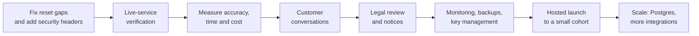

| | |
|---|---|
| **Document** | What is done, what remains, and the order to do it in |
| **Version** | 1.0 |
| **Date** | 2026-11-10 |

---

# 1. Where the product stands

The build order from the research roadmap (foundation, then data trust and compliance, then features, then growth) is
fully implemented. Quarry now has the whole loop: discover, enrich, verify, score, watch, send, sync, bill and
comply. The security fixes from the business audit are done, including the SSRF guard with DNS pinning, the MX check
and the extension of the guard to every outbound fetcher.

What the product does **not** yet have is evidence: no customer conversations have happened, the plan prices are
placeholders, extraction accuracy is unmeasured, and the live-service paths have only been tested with mocks. The
remaining work is therefore mostly verification, legal review and validation, not new features.

# 2. Delivery status by phase

| Phase | Scope | Status |
|---|---|---|
| **1 Foundation** | Durable job queue with retry, cancel and recovery; LLM failures made visible; CI and tests; cookie sessions and CSRF; migrations | Done |
| **2 Data trust and compliance** | Four-state email status with dates; pluggable verifier; provenance; cost estimate and sample run; quotas; suppression ledger, opt-out, erasure, audit log, retention, region flag | Done |
| **3 Features** | Outreach (SMTP and IMAP, sequences, caps, warmup, auto-pause, unsubscribe, DNS preflight); webhooks, API keys; signals and saved-search alerts; waterfall enrichment; batch AI scoring | Done |
| **4 Growth** | Organizations and roles, sharing, billing (Stripe, Razorpay, mock) with credits and top-ups, HubSpot, background CRM pushes | Done |
| **Hardening** | Scraper SSRF guard, guard on all fetchers, DNS-rebinding fix, MX check, mailbox test, async invites, toasts, sticky dialog footer | Done |

# 3. Open work

## 3.1 Must do before a hosted launch

| # | Item | Why | Effort |
|---|---|---|---|
| 1 | Legal review: data-broker status, legitimate-interest assessment, DPA, subprocessor list, terms and privacy notice | The largest unresolved risk; third-party personal data | External |
| 2 | Live-service verification: full pipeline with a real Serper key; email verification providers; real SMTP and IMAP; Stripe and Razorpay (test mode); HubSpot; cost estimate and sample run | Everything so far is mocked | M |
| 3 | Fix password-reset gaps: one-time reset token; revoke sessions on reset | Document 04, gaps 1 and 2 | S |
| 4 | Versioned data-encryption key and secret manager | Rotation currently orphans credentials | M |
| 5 | Proxy security headers, TLS, dependency and secret scanning in CI | Defence in depth | S |
| 6 | Monitoring: uptime, error rate, queue depth, spend | Operate safely | M |
| 7 | Backup schedule and a tested restore; scheduled retention purge | Data safety and compliance | S |

## 3.2 Should do soon

| # | Item | Notes |
|---|---|---|
| 8 | Customer discovery: 5 to 10 conversations with list builders; optional concierge pilot | Validates persona, niche and price; the plan prices are unvalidated |
| 9 | Measure accuracy: labelled set of 100 to 200 leads; track bounce and reply | Backs the "data trust" claim |
| 10 | Measure run time and cost; set real quotas | Replace estimates |
| 11 | Two-account check of shared requests and lists | Open QA item |
| 12 | Contrast and screen-reader audit | Accessibility |
| 13 | Scraper response-size cap | Hardening |
| 14 | Concurrency limit on active runs per user | Document 04, gap 3 |
| 15 | Browser end-to-end smoke tests | Regression safety |

## 3.3 Later

| # | Item | Trigger |
|---|---|---|
| 16 | Postgres, multi-worker queue (`FOR UPDATE SKIP LOCKED`), shared rate limiter | More than one instance, or throughput limits |
| 17 | Pipeline checkpoints so a crash does not repeat spend | Cost complaints after restarts |
| 18 | Gmail and Microsoft OAuth mailboxes | Demand outweighs the security-assessment cost |
| 19 | More CRMs (Salesforce, Pipedrive), Zapier and Make, browser extension | Customer pull |
| 20 | Playwright network isolation or DNS pinning | If Playwright is enabled in production |
| 21 | Metrics and tracing platform | Growth |

# 4. Recommended sequence

Items A to C are engineering and can start now. D and E depend on other people and have the longest lead time, so
start them in parallel.

# 5. Launch criteria

A hosted launch to external users is allowed when all of these are true:

1. Legal review is complete and the privacy notice, terms and postal address are published and configured.
2. Each live integration has passed one recorded end-to-end run.
3. Backups run on a schedule and a restore has been tested.
4. Monitoring pages the operator on downtime or a stuck queue.
5. The pre-hosting checklist in document 05 is fully ticked.
6. At least one real list has been delivered and its bounce rate recorded.

# 6. Success measures after launch

| Measure | Target to calibrate |
|---|---|
| Activation: launch a run within 24 hours of sign-up | Baseline first |
| Time to first result | Under 10 minutes for 25 leads |
| Hard bounce on Verified and Likely emails | Under 2% |
| Runs Completed | Over 95% |
| Enrichment failure rate | Under 5% |
| Honoured opt-outs | 100% |
| Paying conversion | Set after pricing interviews |

# 7. Decision rule

If, after real users receive real lists, none will pay, introduce a colleague or send the list in a live campaign
within a few weeks, the niche or the thesis is wrong. Revisit the premise before writing more features.

# 8. Document index

| # | Document | Contents |
|---|---|---|
| 01 | Product Requirements | Problem, goals, personas, functional requirements, metrics, risks |
| 02 | System Design | Architecture, flows, data and security architecture, decisions, scaling |
| 03 | Data Model and API | Tables, modules, scoring and outreach rules, endpoint catalogue, configuration |
| 04 | Security and Compliance | Threat model, controls, privacy design, legal map, known gaps |
| 05 | Deployment and Operations | Topology, configuration, backups, runbooks, checklist |
| 06 | Test Strategy and QA | Test pyramid, coverage, defects, gaps, release gate |
| 07 | UX and Design Spec | Information architecture, screens, visual system, accessibility |
| 08 | Roadmap and Release Plan | This document |
