# Quarry Customer Guide

From your first search to confident outreach. A practical guide to finding, reviewing, organizing, and engaging the right companies.

## 01. Welcome to Quarry

Quarry helps your team turn a clear customer profile into a focused prospecting workflow. Describe your product and ideal customer, or bring a list of companies you already know. Research companies and decision makers, review the information, and choose the next step: a lead list, an export, outreach, account monitoring, or a CRM handoff.

This guide follows the tasks you will perform in the application. Start with account setup, follow either research workflow, then use the chapters that match your next action.

### What You Can Do

| Your goal | Where to begin | Your next outcome |
|---|---|---|
| Discover companies that fit your offer | Chapters 05-07 | A researched company list to review |
| Find people at known companies | Chapter 08 | Company and decision-maker information |
| Organize and share approved leads | Chapters 10-12 and 19 | A reusable shortlist or export |
| Run personalized outreach | Chapters 13-15 | A controlled, monitored email sequence |
| Follow account changes | Chapter 16 | Saved searches and buying-signal updates |
| Connect sales tools and teammates | Chapters 17-20 | CRM, integrations, workspace, and usage controls |

### Get a Useful First Result

1. Sign in and connect your search key in **Account settings**.
2. Prepare a short description of your product and target customer.
3. Create a request and choose the research route that matches your starting point.
4. Start with 10-25 companies and review the result pattern before expanding.
5. Check company identity, customer fit, contact role, and email status.
6. Add approved leads to a named list before exporting, enrolling, or pushing to a CRM.

> **Good practice:** Treat research as a starting point for a decision. Review AI-assisted information and contact details before acting. A strong score or a present email address is not, by itself, approval to send.

### How to Read This Guide

Bold labels identify controls in the application. Numbered lists are steps to follow in order. Workflow diagrams show how tasks connect. Tips and checkpoints highlight decisions worth making before you continue.

Available integrations and payment options depend on your account and workspace setup. Where a connection is unavailable, ask your workspace administrator for help. Example company names and domains are illustrative; `.example` addresses are not for live sending.

## 02. Your Complete Product Journey

### The Main Workflow

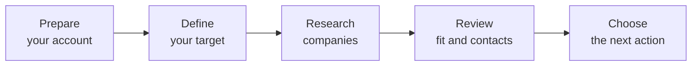

| Stage | Your action | What to check |
|---|---|---|
| Prepare | Sign in, choose your workspace, and connect your search key | You are working in the right account and have available usage |
| Define | Describe your product and ICP, or supply companies and roles | Geography, customer type, and buyer roles match your brief |
| Research | Launch the saved request | The request progresses or gives a clear recovery action |
| Review | Inspect companies, sources, people, and email status | Each approved record is suitable for its intended next use |
| Act | Save, export, enroll, push to HubSpot, or watch | The list, destination, permissions, and sending controls are correct |

### Choose the Right Research Route

**Generate from ICP** is for finding new companies. You describe your product, refine an Ideal Customer Profile, and select **Find matching companies**.

**I already have companies** is for researching target accounts you already know. Enter names or domains, import a CSV if useful, choose buyer roles, and select **Find decision makers**.

Both routes create a request you can reopen and review. A request is research; it is not an outreach campaign or a CRM sync on its own.

### Decide What Happens Next

| What you find | A suitable next step |
|---|---|
| Good company and usable contact | Add to a named list, then choose a controlled handoff |
| Good company but uncertain email | Verify the address or obtain better contact information |
| Good fit but weak timing | Keep the company in a list and review Watch signals |
| Poor fit | Mark or exclude the company from your working shortlist |
| Opt-out request | Add a suppression and review connected campaigns |
| Personal-data removal request | Use the erasure process and handle external copies |

> **Checkpoint:** A completed request means research has finished. It does not mean every result has passed your review. The requested count is a target, not a guaranteed number of qualified companies or verified people.

## 03. Set Up Your Account

### Before You Start

You need your Quarry web address, an account, and access to the intended workspace. Your administrator manages the shared service configuration. Your personal search key is entered in **Account settings**.

| Requirement | Needed for |
|---|---|
| Quarry account and web address | Signing in and accessing your work |
| Personal Serper API key | Live search and lead research |
| Available request allowance and credits | Creating requests and using research tools |
| Mailbox credentials | Outreach, when you choose to enable it |
| Authorized CRM or provider credentials | Optional integrations |

### Register and Sign In

1. Open the Quarry web address supplied by your administrator.
2. On the sign-in page, select **Create an account**.
3. Complete **Full name**, **Work email**, **Organization name**, **Organization domain**, **Password**, and **Confirm password**.
4. Use a strong, unique password and select **Create account**. You are signed in after successful registration.
5. If you have a team invitation, use the email address it was sent to and accept the invitation.
6. Confirm your active workspace before creating or sharing work.

For an existing account, enter **Email** and **Password** and select **Sign in**. Use **Continue with Google** if that option is configured for your service. Team membership is managed separately in **Team settings**.

### Connect Your Search Key

1. Open **Account > Account settings > Integrations**.
2. Enter your **Serper API key**. Use a key from your authorized Serper account and do not include spaces.
3. Select **Save key** and wait for validation.
4. Confirm the Connected state. The saved key is masked and should not be shared in screenshots or support messages.
5. If validation fails, check the key, provider account, and available quota before trying again.

> **Before creating requests:** Set up your key first. Creating a saved request, including a draft, uses a request credit and counts toward your request allowance. Deleting the draft does not return that credit.

### Reset Your Password

Select **Forgot password?**, enter your account email, and select **Send reset link**. Follow the emailed link, enter **New password** and **Confirm password**, and select **Reset password**. If the link is expired or incomplete, request a new one. Check spam folders; if email does not arrive, ask your administrator to check delivery.

### Maintain Your Profile

In **Account settings**, update **Full name**, **Company**, **Job title**, or **Phone number**, then select **Save changes**. Your email address is read-only. Use **Email me a reset link** for password changes. Review account closure with your administrator before using **Delete account**; see chapter 21.

## 04. Find Your Way Around

The sidebar groups research, outreach, and settings. On smaller screens, open the navigation menu before choosing an area. The workspace switcher shows whether you are in Personal workspace or an organization.

| Area | Use it for |
|---|---|
| Requests | Create, reopen, filter, and manage research requests |
| Dashboard | Review recent work, active research, and usage |
| Lead lists | Organize approved companies into named collections |
| Outreach | Connect mailboxes, create sequences, enroll, and view statistics |
| Watch | Save filters and review account signals |
| Integrations | API keys, webhooks, and enrichment-provider keys |
| CRM integrations | HubSpot connection, mapping, and list push |
| Team | Organization membership, invitations, and sharing |
| Billing | Plans, balances, credit packs, and invoices |
| Compliance | Suppression, erasure, retention, and action history |
| Account | Profile, search key, and email-verification settings |

### Use Requests and Dashboard

In **Requests**, use **Search requests**, **Filter by status**, and **Sort by** to find work. A row offers **Open**, **Copy ID**, and **Delete**. Use the page controls to move through longer request lists.

The **Dashboard** summarizes requests and shows an **Active pipeline**. Use **Follow progress** for running work and **View all** for the full request list. The completion metric describes run outcomes, not lead quality.

### Appearance, Help, and Keyboard Use

Use the header for light/dark appearance, a colour palette, Help, and notifications. Appearance is saved in your browser. On desktop, `/` focuses request search, Ctrl/Cmd+B toggles navigation, and Escape closes many dialogs. Use the normal Requests or Dashboard controls to open drafts and runs. Save work before switching workspace, because the page reloads.

> **Tip:** If an in-progress request opens its intake form, return to **Dashboard > Follow progress** to inspect the running result view. Do not create a second request simply to reach progress.

## 05. Prepare a Clear Search Brief

A useful ICP describes the companies and people most likely to benefit from your product. Begin with one coherent segment. Explain both who fits and why that customer would care.

### Include These Details

| Brief element | Example for a fictional product |
|---|---|
| Product | Northstar Cloud Cost Review |
| Value | Identify unnecessary cloud spend and prioritize savings |
| Target company | B2B SaaS businesses with 50-200 employees |
| Geography | United Kingdom and Ireland |
| Relevant context | Production cloud platform; in-house engineering team |
| Buyer roles | Head of Platform, VP Engineering, FinOps Lead |
| Exclusions | Consultancies and consumer-only businesses |
| First target count | 25 companies |

Write a concrete description rather than a broad slogan. For example: "Northstar helps B2B SaaS engineering teams identify waste in cloud costs. We want UK and Irish companies with 50-200 employees and an in-house platform team. Prioritize platform or engineering leaders. Exclude consulting agencies and consumer-only apps."

### Choose Useful Source Material

You can describe the product, use a public product-page URL, or upload TXT, PDF, DOCX, or PPTX material. These sources help fill product details; they are not a document-search library. Use concise, relevant content and put the essential product and buyer facts first.

Text-based PDFs work best. Scanned PDFs need text extraction or OCR before use. Words that appear only inside slide images will not provide reliable product text. Review the extracted fields instead of assuming every page or image was understood.

### Define Your Acceptance Rule

Before launching, decide what makes a company acceptable: correct identity, geography, customer type, relevant business need, and a suitable buyer. Decide what email quality you require before outreach. This makes review faster and keeps scores from replacing your sales judgment.

> **Recommended first run:** Start with 10-25 companies. The supported ICP target is 1-200 companies. Review a small result set before expanding your request.

## 06. Create a Product-Based Request

Use this route when you want to discover new accounts from an Ideal Customer Profile.

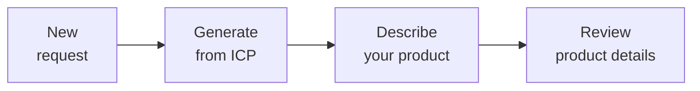

### Create the Request

1. Open **Requests > New request**.
2. Select **Generate from ICP**.
3. Enter **Request name**, such as `UK SaaS platform teams`. The name is required and can contain up to 200 characters.
4. Add an optional **Description** and choose the available **Primary goal** and **Target team size**.
5. Select **Create request** to open Product input.

### Describe Your Product

1. Enter **Product name**. Check it carefully if the request name was used as its starting value.
2. Choose **Describe** and enter **Product description**, or use another source tab.
3. For a public page, choose **Website**, enter **Website URL**, and select **Scrape**. Review the Extracted summary.
4. For files, choose **Documents > Choose files** and select TXT, text-based PDF, DOCX, or PPTX material.
5. Review any product fields already filled in. Description/document extraction is part of **Generate ICP**, rather than a separate earlier step; check the resulting details before finalizing your target.
6. Complete **Additional product details** where useful: category, one-liner, deployment, value proposition, pricing, customers, competitors, deal size, and geography.
7. Set **Target geographies** explicitly and choose **Number of leads** between 1 and 200.
8. Select **Generate ICP** to move to profile review.

Describe also offers **Add target audience**, **Add integrations**, **Add pricing model**, and **Expand pain points**. Read and edit suggested text before using it.

### Save a Reliable Brief

Enter geography and commercial context rather than relying on pre-filled values. Review structured details after each source action: switching between Website and Documents does not ensure that all selected materials are combined. Keep a copy of your original brief and files.

> **Draft tip:** Generated product details and ICP edits can be saved, but raw file selections, website inputs, and your chosen count may need re-entry when you return. Check the count and all launch inputs before continuing a draft.

## 07. Refine Your ICP and Launch

The ICP review step turns your product brief into editable targeting criteria. Read every section before researching companies.

### Review the Six Sections

| Section | What to look for |
|---|---|
| Firmographics | Industry, size, geography, and company type |
| Technographics | Relevant platforms and technology context |
| Team & decision makers | Appropriate departments and buyer roles |
| Buying signals | Events that may make your offer timely |
| Compliance needs | Applicable business requirements to review |
| Deployment preferences | Suitable hosting or delivery model |

1. Open each card and use **Show more** to inspect hidden bullets.
2. Select **Edit**, enter **One bullet per line**, and select **Save changes**.
3. Remove broad suggestions, add missing criteria, and check exclusions.
4. Use **Verify consistency** to look for contradictions. Review any warnings.
5. Use **Regenerate ICP** only if you want new suggestions, or **Modify inputs** to correct the product brief and count.
6. Select **Save draft** if you are not ready to launch. Resolve any unsaved-change warning before leaving.

Confidence labels help organize the review; they are not independent confirmation that the target is correct. Compare the profile with your original brief.

### Estimate and Sample

The **Cost estimate** shows approximate searches, model calls, and expected usage. It is a planning aid, not a provider invoice or guaranteed completion time.

Use **Run a sample first** to inspect a small candidate preview. Review its titles, URLs, snippets, and Search used. A sample is not a fully enriched final list. If it is off-target, revise your ICP and select **Run sample again**. Samples use live search and can consume provider quota.

### Launch the Request

1. Confirm the product, geography, exclusions, roles, and 1-200 target count.
2. Check your saved search key, request allowance, and usage estimate.
3. Select **Find matching companies** once.
4. Wait for **Request launched**, then select **View requests** or return through Dashboard.
5. Use **Dashboard > Follow progress** to review the running request.

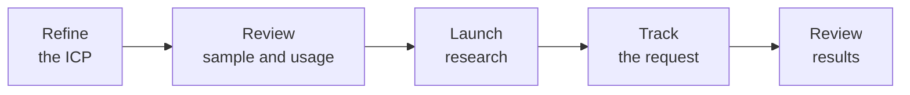

Research continues after you leave the page. Avoid duplicate launches while waiting. When it finishes, begin review rather than moving directly to outreach.

## 08. Research Companies You Already Know

Choose this workflow when you have target-account names or domains and want company and decision-maker information.

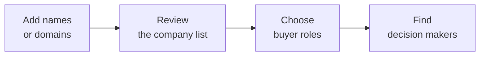

### Add Companies Manually

1. Open **New request** and select **I already have companies**.
2. Name the request and select **Create request**.
3. Enter **Company names or domains** and select **Add** or press Enter. Commas and newlines separate entries; Shift+Enter adds a newline.
4. Review the added chips. Remove duplicates, misspellings, and irrelevant companies. A company is not included until you add it.
5. Add **Target roles** with Add/Enter or use suggested role chips. Leaving roles empty uses broad CEO, Founder, or Owner roles.
6. Select **Find decision makers** and follow the saved request.

Company entries can be up to 200 characters and custom roles up to 80 characters. Domains usually reduce ambiguity compared with common company names.

### Import a CSV

1. Select **Download template** for a `company_name` example.
2. Prepare a UTF-8 CSV with a recognizable company or domain header.
3. Select **Upload CSV**. The browser accepts `.csv` files up to 2 MB; your service may have a lower upload limit.
4. Inspect the parsed list. Correct headers or use a smaller file if the import is wrong or rejected.
5. Add roles and launch only after the company chips are correct.

```csv
domain
analytics.example
platform.example
```

Recognized headers include company, company_name, name, domain, and website. An unrecognized header can cause the first column to be used. The import creates company entries, not a complete contact spreadsheet.

> **Before leaving:** Keep your source list and roles until launch succeeds. The direct-company editor does not provide a reusable saved-input draft. Use Requests or Dashboard to reopen the resulting request.

## 09. Track Research and Handle Delays

Open the same request rather than creating a replacement whenever you want to check progress. Results update while the run is active.

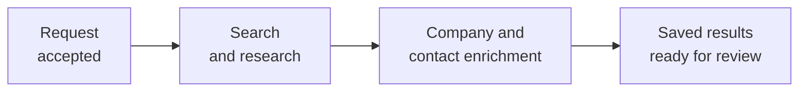

| Status or condition | What it means | What to do |
|---|---|---|
| Running / Pending | Research is queued or in progress | Wait and reopen the same request |
| Completed | Processing finished | Review company fit and contacts |
| Failed with partial results | Work stopped but some leads were retained | Read the reason and inspect useful retained data |
| Failed without results | The run could not return usable leads | Correct the reported issue before another launch |
| Enrichment failed on a company | Some company details could not be completed | Open the drawer and use Retry enrichment after the issue is resolved |
| Fewer results than requested | Public evidence, targeting, or available candidates limited output | Review the target and broaden deliberately if appropriate |

### Recover Safely

1. Read the displayed reason and note the request name or ID.
2. Check your search-key validation and provider quota if search is mentioned.
3. Keep useful partial results instead of deleting the whole request.
4. For a company-specific issue, open its drawer and select **Retry enrichment**. Give the retry time to finish.
5. If progress remains stalled, contact your administrator with the request ID and approximate time.
6. Re-launch only after understanding the issue. Repeated research can use additional credits or provider quota.

Deleting a request permanently removes its research data; it is not a pause or retry control. Ask your administrator about stopping a running job when necessary.

## 10. Review Company Fit and Research

Begin with identity, then fit, then timing. Use scores to prioritize review rather than as a substitute for supporting information.

### Work Through the Companies View

1. Open the request and select **Companies**.
2. Search by company, contact, or location. Use **Filters** for industry, headcount, funding, region, signals, growth, or technology.
3. Review **Recommended**, **Saved**, **Excluded**, **Valid**, and **Invalid** as needed. Recommended means not yet classified; it is not a separate approval.
4. Check the company name and website before reading the score.
5. Click the company to open its drawer. Review **Why it matches**, **Contact**, **Company facts**, **Technology**, and signals.
6. Open source links and confirm that the information supports your brief and is still relevant.
7. Use the row menu to save, exclude, mark valid/invalid, or **Add to list...**.

The first 25 rows are shown initially; **Show more** reveals additional rows. If results remain filtered after Clear, check header search too. Filters rely on available extracted information and may not cover every company characteristic.

### Interpret Scores and Sources

| Indicator | Use it for | Keep in mind |
|---|---|---|
| Match score | Relative fit with an ICP | Check actual criteria; supplied-company scores are not an independent ICP assessment |
| Intent score | Research priority and potential timing | Read the supporting event and analysis date |
| Contact relevance | Comparing people within the result set | It is a ranking aid, not confirmed buying authority |
| Contact confidence | Deciding what needs further review | It is separate from email verification |
| Source marker | Opening a reference and checking retrieval context | Confirm the fact on the source page; a link alone is not proof |

AI-assisted fields can be incomplete or inaccurate, and contact sources can be indirect. Validate important claims before repeating them in outreach.

### Analyse Intent

Open **Intent analysis** in the company drawer and select **Analyse intent**. Review the summary, suggested action, score breakdown, signals, and source links. Use **Refresh** for a deliberate new analysis. This action uses search quota; timing guidance is an estimate.

Bands are Hot (80-100), Warm (60-79), Nurture (40-59), Watch (20-39), and Cold (0-19). They are research indicators, not probabilities of purchase, and stored results should be refreshed when timing matters.

### Competitors and Manual Adds

For an ICP request, select **Competitors** to inspect alternatives. Filter by size, rating, overlap, or tier. Select **Compare** on up to three cards and open the comparison drawer. Verify claims and ratings against current sources.

**Manual adds** stores a company name and optional website on the request. It does not automatically research the company or find people. Use the known-company workflow when you need enrichment for supplied accounts.

## 11. Review People and Verify Emails

### Find the Right Person

1. Select **Decision makers** and choose a company.
2. Use **Search contacts**, **Seniority**, **Persona**, or **With email only** to focus the list.
3. Check name, current employer, role, and available profile links.
4. Read the separate email status, reason, and check date.
5. Hold uncertain contacts for review rather than automatically enrolling everyone with an address.

With email only means an address is present, not that it is deliverable. A generic contact, shared inbox, or inferred name/address needs additional review. The contact-confidence label is not email verification.

### Understand Email Status

| Status | Meaning | A sensible next action |
|---|---|---|
| Verified | An affirmative mailbox-level check was recorded | Review its method and date, plus permission to contact |
| Likely | Basic/domain checks passed without decisive mailbox proof | Verify further or apply a conservative review policy |
| Risky | Catch-all, shared inbox, or another uncertainty | Hold or obtain better information |
| Invalid | A decisive check failed | Do not send; correct or remove the address |
| Unchecked | No usable check is recorded | Treat it as unknown |

### Verify an Address

Open the company drawer and select **Verify email**, or **Re-check** for an existing result. Lead-list rows also expose verification. Wait for the result and read the reason/date. Individual decision-maker statuses are visible in the contact panel; direct per-person verification may require an administrator-assisted action.

Free checks assess syntax, disposable domains, and mail-domain records. Domain checks alone do not confirm a person's mailbox. Optional paid verification and SMTP checks can provide more information, but a technical result does not establish consent or guarantee delivery.

### Set Verification Preferences

Open **Account settings > Email verification**, choose **Paid provider (optional)** or **None, free checks only**, enter a provider key if required, and select **Save settings**. Enable direct SMTP probing only when appropriate for your network/provider. Review a sample result after changing settings.

### Fill Missing Contact Information

**Integrations** provides Hunter, Snov, and People Data Labs key settings and a separate email-lookup credit balance. An administrator-assisted waterfall lookup can try available sources for missing emails. Existing addresses, including inferred ones, may be left unchanged. Verify any returned address before outreach.

Your own provider keys can incur provider charges even when no Quarry lookup credits are charged. Keep search, verification, and enrichment credentials in their intended settings.

## 12. Build Lists and Export

Named lists turn reviewed research into a repeatable handoff. A company's Saved mark in a request is not the same as membership in a named list.

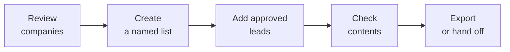

### Create and Populate a List

1. Open **Lead lists > New list**.
2. Enter **List name** (up to 80 characters), an optional **Description** (up to 200), and choose **Colour**.
3. Select **Create list**. Use a specific name such as `UK SaaS - reviewed platform buyers`.
4. Return to request results, select reviewed companies, and use row, drawer, or bulk **Add to list**.
5. Choose the existing list; the picker does not create a new list inline.
6. Reopen the list and verify its contents before exporting or enrolling.

Use list search, rename with **Save name**, verify lead emails, or remove unwanted members. Removing a member keeps the lead in its original request. **Delete list** removes the collection, not the underlying research.

### Choose an Export

| Export | Available in the browser | Scope |
|---|---|---|
| Request companies | CSV, Excel, PDF | The request's company results |
| Request competitors | CSV, Excel, PDF | The request's competitor results |
| Decision makers - Export all | CSV, Excel, PDF | Contacts across the request |
| This company (CSV) | CSV | All loaded contacts for the selected company |
| Named lead list | Export CSV | The whole selected list |

1. Decide whether you need the whole request or only an approved shortlist.
2. For a shortlist, build a named list first and use **Export CSV** from that list.
3. Choose the appropriate format. CSV is useful for imports; Excel for spreadsheet review; PDF for a readable report.
4. Open the download and check row count, fields, contact data, and source notices.
5. Review unwanted or suppressed records before transferring the file securely.

> **Export scope:** Table filters, saved/valid views, and selected rows do not limit request exports. A list export also includes the whole list. Inspect the download; do not assume that only visible rows were exported.

Formats do not carry identical fields. The decision-maker PDF does not include email addresses. **This company (CSV)** is a browser-generated shortcut and does not apply the same suppression checks as standard server company/contact/list exports. Public API data, integration exports, and CRM pushes also need a separate do-not-contact review.

## 13. Connect Your Sending Mailbox

Quarry uses SMTP to send and IMAP to detect replies and bounces. Signing into Quarry with Google does not connect a sending mailbox.

### Prepare the Connection

Have the sender email/name, SMTP host/port/password, and IMAP host/password ready. Use your provider's approved settings or app password. Confirm that SMTP/IMAP access is permitted. Your administrator should also confirm a real postal footer and working public unsubscribe links.

### Connect and Check

1. Open **Outreach > Mailboxes > Connect mailbox**.
2. Enter **Email address**, **From name**, **SMTP host**, **SMTP port**, and **SMTP password**.
3. Enter **IMAP host (reply detection)** and **IMAP password**. A blank IMAP password reuses the SMTP password.
4. Set **Daily send cap** conservatively and leave **Ramp up gradually (warmup)** enabled for a new sender.
5. Select **Test connection** and inspect SMTP and IMAP separately.
6. Correct provider authentication or network issues, then test again.
7. Select **Connect**, then **Check DNS** on the saved mailbox. Review SPF, DKIM, and DMARC with your mail administrator.
8. Test sending, replying, and unsubscribing using an authorized internal recipient before a prospect campaign.

### Understand Sending Limits

| Control | What to expect |
|---|---|
| Default daily cap | 40 sends per mailbox; choose a lower limit when appropriate |
| Warmup | A gradual cap ramp starting near five per day |
| Default window | Weekdays, 09:00-17:00; check the sequence timezone |
| Bounce protection | A high hard-bounce rate can automatically pause the mailbox |

Warmup is a volume control, not a guarantee of inbox placement. Connection tests confirm access, not campaign deliverability. If you need to change an existing mailbox or use different authentication settings, ask your administrator. The mailbox delete icon removes the connection and should not be used as a test control.

> **Before outreach:** Review recipients, email status, sender identity, DNS, postal address, and unsubscribe links yourself. A sequence being startable does not replace these checks or establish permission to contact.

## 14. Create an Outreach Sequence

A sequence contains scheduled email steps. An enrollment is one contact participating in that sequence. Begin with a reviewed list and a tested mailbox.

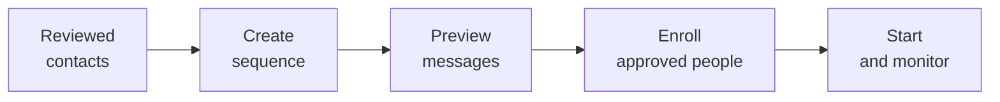

### Write the Sequence

1. Open **Outreach > Sequences > New sequence**.
2. Enter **Name**, choose **Send from**, and set **Time zone** deliberately.
3. Complete **Subject 1** and **Body 1** with a specific, truthful reason to contact the person.
4. Use **Add follow-up** only when another message adds value. Set **Wait (days)** before each later step.
5. Review all steps; a sequence can contain up to eight. A blank later subject is intended to continue the thread.
6. Select **Create sequence** to save without starting.

Prepare carefully before creation. Editing or deleting an existing sequence may require administrator assistance. Keep active sending paused while arranging changes.

### Personalize with Fallbacks

Variables include first_name, last_name, name, title, company, email, domain, and sender_name. Use a fallback when a field may be missing.

```text
Subject: Cloud-cost review for {{company}}

Hi {{first_name|there}},

I work with SaaS teams on identifying avoidable cloud spend.
If this is relevant to your team, would a short summary help?

{{sender_name}}
```

This example shows syntax, not a universal script. Do not claim knowledge of a company's funding, technology, or challenges unless your research supports it.

### Preview, Enroll, and Start

1. On the sequence card, select **Add leads** and choose **Lead list**, then **Preview**. Alternatively select decision makers, choose **Add to sequence**, and select a sequence.
2. Inspect every subject/body and any Missing field warning. A list preview is not a check of every list member; a selected-contact preview uses the first supplied contact.
3. Select **Enroll** and review enrolled/skipped counts.
4. Confirm the recipients, sending mailbox, timezone, cap, and footer/unsubscribe setup.
5. Select **Start** only when everything is ready. Use **Pause** to stop further due sends while investigating.

Starting can send real email. Closing the browser does not stop the sequence, and pausing cannot recall messages already sent.

## 15. Monitor Replies and Campaign Health

Open **Outreach > Sequences** and select **Stats** on the relevant card. Review contacted, replies, bounces, unsubscribed, reply rate, and per-step performance. Use the real mailbox to read and answer conversations.

### Interpret Outcomes

| Outcome | Your next action |
|---|---|
| Waiting to send | Check window, timezone, step delay, cap, warmup, and mailbox state |
| Sent | Review later delivery/reply signals; SMTP acceptance is not inbox delivery |
| Replied | Continue personally and confirm the sequence has stopped for that person |
| Bounced | Investigate the address and prevent repeat attempts |
| Unsubscribed | Respect the opt-out and do not re-enroll |
| Completed | Evaluate the outcome before deciding on future contact |
| Failed | Read the error and correct the cause before retrying |

### How Replies Are Detected

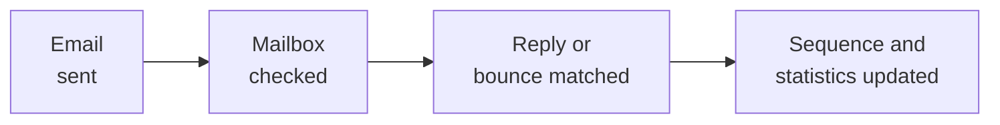

IMAP checks happen periodically, so an update may not be immediate. Check the mailbox directly as well as Quarry's statistics. Open tracking is off by default; open events, where enabled, are affected by mail-client privacy behavior and are not proof of a meaningful conversation.

### Resume a Paused Mailbox Carefully

1. Read the pause reason and pause affected sequences if necessary.
2. Review bounces, inferred addresses, catch-all results, and stale contacts.
3. Re-check connection and DNS when configuration may be involved.
4. Confirm cap, warmup, timezone, and revised recipient quality.
5. Select **Resume** only after correcting the cause.

Temporary sending errors can be retried automatically. Avoid repeatedly restarting a sequence to bypass a queued retry or safety pause. Each day, handle replies, review opt-outs/bounces, and approve new enrollments before increasing volume.

## 16. Monitor Accounts with Watch

Watch helps you revisit stored leads and identify changes worth investigating. Use a new research request when you need new accounts; saved searches do not launch fresh market discovery.

### Create a Saved Search

1. Open **Watch > Saved searches**.
2. Enter **Name**, **Keywords**, and **Minimum score** between 0 and 100.
3. Add an authorized **Slack incoming-webhook URL** if useful. Email alerts depend on the service's configured email delivery.
4. Select **Save search**, then **Run now** to inspect the new-match count.
5. Confirm the definition is useful. To change it, delete and recreate the saved search.

Existing matches may already be marked seen when a search is created. An initial match therefore does not necessarily generate a new alert.

### Review Buying Signals

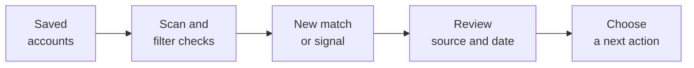

Open **Watch > Signals** and use **Scan now** for a manual scan. Review the domain, signal type, and summary shown in Watch; confirm timing and facts against original public sources. The first scan establishes a baseline; later observations can show hiring, funding/news, and technology changes.

Scheduled checks are typically about six hours apart. A scan considers a limited set of domains, so large collections are not necessarily checked simultaneously. Missing signals do not prove that nothing changed. Use an event as a reason to research further, not as an unsupported claim in a message.

## 17. Push Reviewed Lists to HubSpot

Use HubSpot to hand a reviewed list into your sales process. Confirm the destination portal, account permission, and plan availability before connecting.

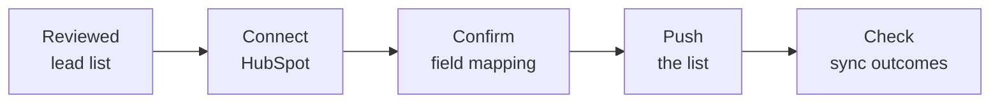

### Connect and Map

1. Open **CRM integrations**.
2. Enter **Private app access token** and select **Connect HubSpot**, or use **Sign in with HubSpot** when available.
3. Use authorized company/contact read/write permissions. In a team, an owner/admin manages the connection and mapping.
4. Confirm the correct HubSpot portal.
5. Review **Company fields** and **Contact fields**. Domain/email matching fields are locked; blank mappings skip a field.
6. Confirm that custom destination properties already exist, then select **Save mapping** if needed.

Mapped nonblank values can update existing CRM fields. Review the mapping against your CRM ownership rules before the first push.

### Push and Confirm

1. Choose the approved **Lead list** and select **Push to HubSpot**.
2. Inspect Queued, Syncing, Synced, or Failed states for individual leads.
3. Open HubSpot and spot-check company/contact identities and associations.
4. Read any error and use **Retry failed** after correcting it.

Companies are matched by domain and contacts by email. A finished batch can still contain failed leads, so inspect the summary. After OAuth returns, open CRM integrations again if necessary.

### Keep the Handoff Responsible

This is a one-way list push, not automatic two-way synchronization of every edit, opt-out, or deletion. Review do-not-contact records before pushing, and handle later removals in both systems. Disconnecting HubSpot does not remove records already sent there.

For other CRMs, use an approved CSV handoff or authorized integration. Zapier/Make-style hooks are available for technical setup; ask your administrator to configure the receiver and test it before using customer data.

## 18. Manage Integrations and API Access

Use **Integrations** for public API keys, webhooks, and optional email-lookup providers. These are distinct from the personal search and verification keys in Account settings.

| Setting | Purpose |
|---|---|
| Serper key | Search and company research |
| Verification-provider key | Technical email checks |
| Enrichment-provider key | Additional missing-email lookup sources |
| Quarry API key | External read access to requests and lists |
| Webhook secret | Authenticating events at your receiver |
| HubSpot connection | Sending a reviewed list into the CRM |

### Create and Revoke an API Key

1. Open **Integrations > API keys**.
2. Enter **Key name** and select **Create key**.
3. Store the key securely when shown. It is shown once.
4. Give it only to the approved application that needs read access.
5. Use **Revoke** when it is no longer needed or may have been exposed.

Public keys support read-only access at `/api/public/v1`. They do not start research, send email, or provide unrestricted administration.

### Connect a Webhook Receiver

1. Prepare an HTTPS endpoint controlled by your team.
2. In **Integrations > Webhooks**, enter **Endpoint URL** and select **Add webhook**.
3. Store the signing secret in the receiving system.
4. Select **Send test** and confirm receipt and signature validation.
5. Use **Disable / Enable** to control delivery, or **Delete** to remove the hook.

Your technical team should verify `X-Quarry-Signature`, handle retries safely, and monitor failures. General webhooks and Zapier/Make-style hooks have different verification details; use the instructions appropriate to the connection.

### Technical Read-Access Example

Use the authorized service's HTTPS API address and keep the key in an approved secret store or environment variable.

```http
GET /api/public/v1/requests
Authorization: Bearer <your_api_key>
```

Read routes also include `/lists`, `/requests/{id}/leads`, and `/lists/{id}/leads` under that prefix. Public read data and CRM/integration handoffs need their own do-not-contact review. Your administrator can use the service's interactive API documentation for advanced settings and operations.

## 19. Work with Your Team

Workspaces organize membership and explicitly shared research. Personal keys, some balances, and privacy actions remain individual; selecting an organization does not automatically pool everything.

### Create or Join an Organization

1. In Personal workspace, open **Team settings > Create an organization**.
2. Enter **Organization name** and select **Create organization**.
3. Choose the organization in the workspace switcher.
4. If joining by invitation, sign in with the invited email and select **Accept invitation**.

Save work before changing workspace because the page reloads.

### Invite Teammates

1. An owner/admin opens **Team > Invite people**.
2. Enter **Email**, choose **Role**, and select **Send invite**.
3. Review email delivery. Use **Copy link** privately if email is unavailable.
4. Have the recipient use the invited address and accept within seven days.
5. Use **Revoke** to invalidate an unused invitation.

| Role | Typical responsibility |
|---|---|
| Owner | Workspace ownership and highest administrative authority |
| Admin | Membership, invitations, billing, and integration administration |
| Member | Day-to-day research and sharing eligible work |
| Viewer | Reading work explicitly shared by the team |

### Share a Request or List

1. In the intended organization, open **Team > Shared with this team**.
2. Use **Share one of your lists or requests**, choose the item, and select **Share**.
3. Confirm a teammate can open the shared section.
4. Use **Stop sharing** when access is no longer needed.

Shared requests provide a compact read-only summary; shared lists provide read-only lead rows. Unsharing does not recall downloaded files or external copies. During offboarding, review membership, shared data, and any external keys or mailbox/CRM access the person could use.

## 20. Understand Billing and Usage

**Billing** is the place to check your current plan, available balances, credit options, and invoices. Use the prices and limits displayed in your account rather than assuming a fixed catalogue.

### Understand the Balances

| Limit or balance | What it controls |
|---|---|
| Request credits | Creating saved research requests, including drafts |
| Monthly request allowance | How many requests your plan permits |
| Research usage | Available launches and estimated provider usage |
| Email-lookup credits | Eligible missing-email lookups; a separate personal balance |
| Provider quota | Limits or charges on your own search/verification/enrichment account |

A credit balance does not override every other limit. A top-up does not necessarily increase your monthly request allowance. Creating a request uses one request credit; deleting it does not refund the credit. Samples, repeats, and additional analysis can use external-provider quota.

### Add Credits or Change Plan

1. Check the active workspace and identify the balance or limit blocking your task.
2. If top-ups are available, select **Credit pack** and **Add to** Request credits or Email lookup credits.
3. Select **Add credits** and complete the offered checkout.
4. Return to Billing and confirm the updated balance and invoice status.
5. For a plan change, use an available **Upgrade to ...** option and confirm the resulting plan.
6. If a balance is missing or payment is pending, contact your administrator before paying again.

Owners/admins manage team billing. Payment options depend on service configuration; if checkout is unavailable, ask your administrator. For cancellation or payment-method changes not provided on screen, use your organization's billing process.

### Review Value, Not Only Volume

Compare usage with approved companies, useful contacts, and real conversations. Start small, refine the segment, and scale only after the result pattern is useful. Estimates are planning aids, not final provider invoices.

## 21. Manage Opt-Outs and Personal Data

**Compliance** provides suppression, erasure, retention, and action history. Use these tools alongside your organization's privacy and marketing policies. A public business address or a good fit score does not establish permission to contact someone.

### Choose the Right Action

| Need | Use |
|---|---|
| Stop future contact for an email/domain | Suppression |
| Remove a person's stored contact data | Erasure plus external-copy handling |
| Remove poor-fit or expired research | Rejection/retention process |
| Stop a live email sequence | Pause the sequence |
| Remove team visibility | Stop sharing |

### Add a Suppression

1. Open **Compliance > Suppression list**.
2. Enter **Email or domain** and an optional **Reason**.
3. Review spelling and scope; a domain includes its subdomains.
4. Select **Add** and check relevant active enrollments.
5. Coordinate with teammates when the same person appears in their independent records.

Suppression is individual to the relevant user/sender, not automatically organization-wide. Standard company/contact/list exports apply suppression checks, but local company CSV, public API, integration exports, and CRM handoffs need separate review.

### Give a Recipient an Opt-Out Path

Enter a full email in the suppression form and select **Opt-out link**. The recipient can select **Opt out** on the public page without a Quarry account. Test campaign unsubscribe links before sending. If a recipient reports a broken link, pause affected sending and resolve the issue through your administrator.

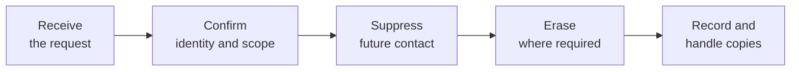

### Erase Contact Data

1. Follow your organization's identity and deletion procedure.
2. Open **Erase a person** and enter **Email address**.
3. Review **Also add to the suppression list**, select **Erase data**, and confirm **Erase**.
4. Check the reported result and action history.
5. Handle CRM records, exports, mailbox history, and other external copies separately.

Erasure is scoped to the relevant account. It does not automatically recall downloads or remove every external record.

### Retention and Account Closure

Use **Reject lead** in a drawer or **Restore lead** if a rejection was mistaken. Rejected leads are eligible for deletion after 30 days; restore them before retention cleanup if needed. Retention can also remove expired and old unenriched/unlisted leads. **Delete expired leads now** performs a real deletion; review the scope with your administrator first. A Saved company mark is not the same as named-list membership.

Before account closure, pause outreach, revoke integrations/keys as appropriate, and ask the administrator to review remaining scheduled activity and connected records. **Delete account** is destructive, but some automation/integration resources can require separate cleanup. Keep required opt-out instructions and handle external copies under your organization's policy.

## 22. Put the Workflow into Practice

### Example: From Product Brief to Outreach

Imagine you sell **Northstar Cloud Cost Review** to UK and Irish B2B SaaS companies with 50-200 employees. Your buyer is a platform or engineering leader, and your first research target is 25 companies.

1. Sign in, choose the workspace, and connect your personal search key.
2. Create `UK SaaS platform teams` and choose **Generate from ICP**.
3. Describe your offer and set geography, size, roles, and exclusions explicitly.
4. Review all six ICP cards and correct the suggestions.
5. Set a target of 25, inspect the estimate/sample, and launch once.
6. Review company identity, fit, sources, and timing.
7. Check each prospective buyer's employer/role and email status.
8. Create `UK SaaS - reviewed platform buyers` and add only approved companies.
9. Choose a handoff: export, HubSpot, outreach, or Watch.
10. For outreach, connect/test the mailbox, preview the sequence, enroll approved contacts, and Start.
11. Monitor real replies, bounces, and opt-outs; update the list and next actions.

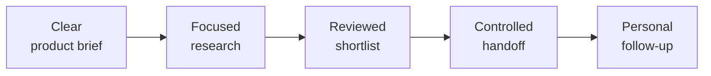

This is an illustrative process, not a promise of a particular result count, cost, or response rate.

### Before Launching Research

- Correct workspace, product, geography, buyer roles, and exclusions.
- Target count between 1 and 200.
- Reviewed ICP and useful sample direction.
- Valid search key and available request/usage allowance.
- Original brief and source material retained for future edits.

### Before Exporting or Sending

- Company identity, fit, and supporting information checked.
- Contact employer/role and email status reviewed.
- Correct list and export scope confirmed.
- Opt-outs, recipient permissions, and external-copy handling considered.
- For email: tested mailbox, DNS, sender identity, postal address, unsubscribe links, timezone, and conservative cap.

### A Practical Weekly Routine

Start with replies, bounces, opt-outs, and failed work. Refresh stale contact checks. Review Watch signals, then create only the new research you need. End the week by evaluating useful conversations and accepted leads rather than generated row counts alone.

## 23. Troubleshooting and Quick Reference

### Access and Research

| If this happens | Try this |
|---|---|
| Sign-in fails repeatedly | Check credentials, use password reset if needed, and respect any retry delay |
| Reset/invitation email does not arrive | Check spam and address spelling, then ask your administrator about email delivery |
| Search-key warning remains | Save and validate the personal key in Account settings; check provider quota |
| PDF yields little product text | Use a text-based document, OCR a scan, or paste a concise description |
| Website/documents do not appear combined | Review structured product fields after each source action and add missing facts |
| ICP is off-target | Edit the cards and explicit geography/roles before launching |
| A larger count is rejected | Enter a whole number between 1 and 200 |
| Draft inputs are missing | Re-enter files, direct-company inputs, and count from your saved brief |
| CSV imports the wrong column | Use a recognized company/domain header and inspect parsed chips |
| Run stays Pending | Reopen the same request through Dashboard; contact your administrator with its ID |
| Results are fewer than expected | Review available evidence and broaden the target deliberately |
| One company shows enrichment failure | Resolve the reported issue, then use Retry enrichment in its drawer |

### Lists, Outreach, and Connections

| If this happens | Try this |
|---|---|
| Contact confidence looks good but email is uncertain | Read the separate email status, reason, and date; verify further |
| Export includes extra rows | Use a curated named list and inspect the whole-list download |
| Active sequence has not sent yet | Check time window, timezone, delays, cap, warmup, enrollment, and mailbox state |
| Replies are not reflected in Stats | Test IMAP and check the real mailbox; allow for periodic polling |
| Mailbox is paused | Review bounces and list quality before Resume |
| Unsubscribe link fails | Pause sending and ask the administrator to fix/test the public link |
| Watch does not discover new companies | Run new research separately; Watch filters stored leads |
| First scan shows no changes | It establishes a baseline; review later scans |
| HubSpot push fails | Check permission, destination, credentials, mapping, and per-lead errors |
| Webhook test fails | Check receiver availability, hook state, and signature setup with your technical team |
| Payment/balance is pending | Check Billing status and contact your administrator before purchasing again |
| Credits remain but work is blocked | Check monthly request allowance, research usage, and provider quota separately |

### Contact Your Administrator

Share the request name/ID, approximate time, action taken, and exact visible message. Include a redacted screenshot only when helpful. Do not send passwords, provider keys, session tokens, private mailbox contents, or unnecessary personal data.

### Glossary

| Term | Meaning |
|---|---|
| ICP | Ideal Customer Profile: the company and buyer you want to reach |
| Request | One saved research task and its inputs/results |
| Lead | A researched company record |
| Decision maker | A potential buyer or relevant employee at a company |
| Match score | A research indicator of fit, not a guarantee |
| Intent | Signals that may make an account worth investigating now |
| Verification | A dated technical email check, separate from permission to contact |
| Lead list | A named collection of selected company leads |
| Enrollment | One contact participating in an outreach sequence |
| Suppression | A do-not-contact instruction for an email/domain |
| Erasure | Removing stored personal data within the action's scope |
| Webhook | An event delivered to an external receiver |
